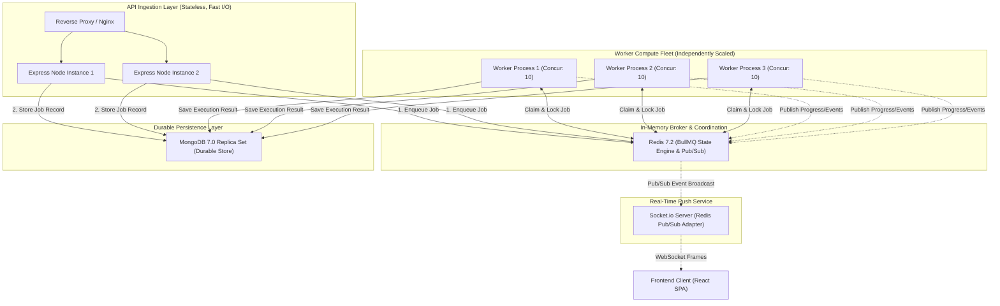
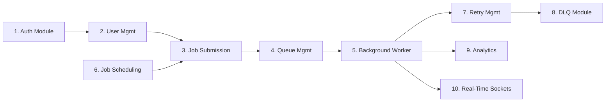
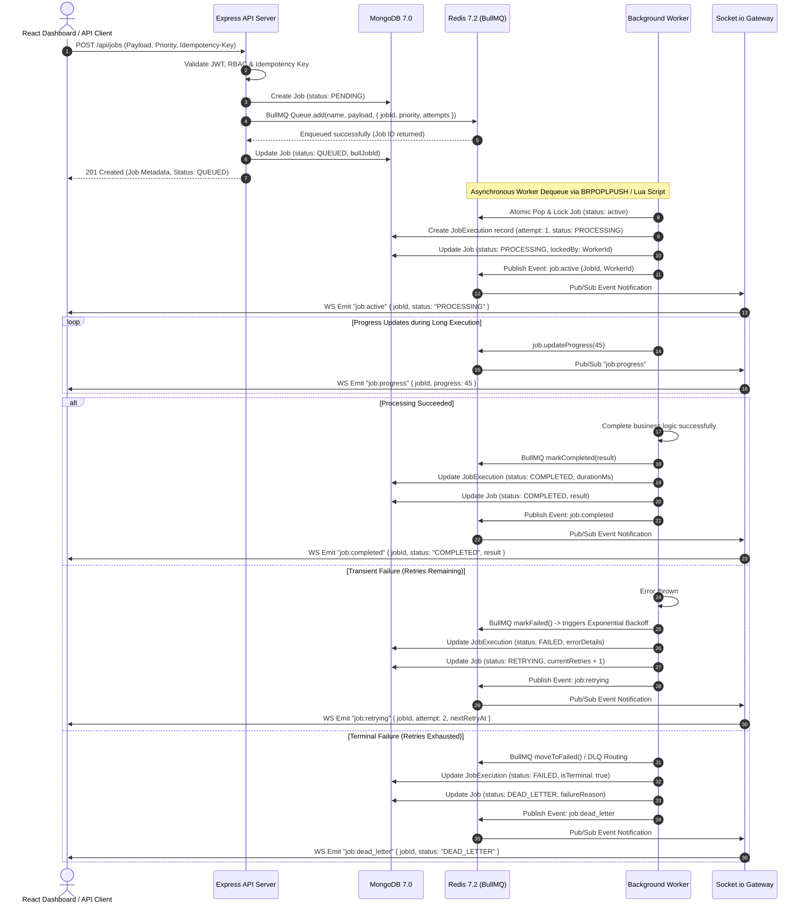
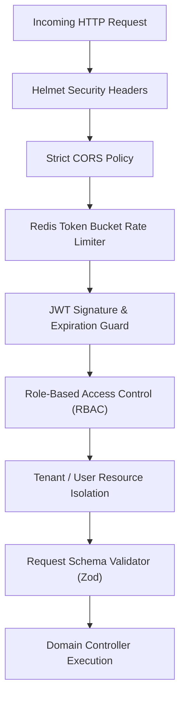

# TaskFlow — System Architecture Specification

## 1. Architectural Philosophy & Topological Pattern

### 1.1 Modular Monolith with Decoupled Worker Execution
TaskFlow is architected as a **Modular Monolith with Decoupled Worker Processes**. In modern high-throughput distributed systems, separating the HTTP API layer from background compute workers is essential to avoid resource starvation, event loop lag, and cascading failures. 

Rather than adopting a complex, distributed microservices network—which introduces distributed transaction overhead, network latency, and orchestration complexity—TaskFlow employs a single unified codebase written entirely in **TypeScript** where:
1. **API Ingestion Service (`server.ts`)**: Runs an Express HTTP server optimized for low-latency request validation, authentication, rate limiting, and fast writes into MongoDB and Redis.
2. **Background Worker Engine (`worker-entry.ts`)**: Runs one or more independent Node.js processes optimized for long-running, CPU/IO-bound asynchronous tasks.
3. **Shared Domain Core**: Both runtimes share data models, validation schemas, TypeScript interfaces, and logger infrastructure without network hops.
4. **Horizontal Scalability**: Worker processes scale independently of the API server (e.g., scaling workers to 10 replicas while running 2 API replicas in Docker Compose).



---

## 2. The 10 Core Architectural Modules

The system is organized into ten distinct, decoupled domain modules adhering to the **Single Responsibility Principle (SRP)**:



### Module 1: Authentication & Authorization Module
- **Purpose**: Authenticates clients and protects endpoints using signed JSON Web Tokens (JWT) and cryptographic password hashing.
- **Components**:
  - `AuthService`: Generates short-lived Access Tokens (15 min) and long-lived Refresh Tokens (7 days). Passwords hashed with `bcrypt` (12 salt rounds).
  - `JwtMiddleware`: Validates token signature, token expiration, and extracts user payload.
  - `RbacGuard`: Enforces role-based permissions (`admin`, `developer`, `viewer`).

### Module 2: User Management Module
- **Purpose**: Manages user entities, organizations/tenants, and API key generation for programmatic job submission.
- **Components**:
  - `UserRepository`: Mongoose CRUD wrapper with lean queries for fast identity lookups.
  - `ApiKeyService`: Generates secure prefix-based API keys (`tf_live_...`) hashed with SHA-256 for non-browser automation clients.

### Module 3: Job Submission Module
- **Purpose**: Serves as the high-throughput intake pipeline for background job requests.
- **Components**:
  - `JobValidator`: Enforces payload schema validation using strict type checking.
  - `IdempotencyEngine`: Checks incoming `Idempotency-Key` headers against active Redis locks and MongoDB records to prevent duplicate ingestion.
  - `JobDispatcher`: Persists the initial job entity to MongoDB (`status: QUEUED`), translates parameters into BullMQ queue options (priority, delays, backoff), and pushes the job into Redis.

### Module 4: Queue Management Module
- **Purpose**: Controls queue-level runtime configurations, state toggles, and concurrency limits.
- **Components**:
  - `QueueRegistry`: Singleton registry of active BullMQ `Queue` instances keyed by queue name.
  - `QueueController`: Supports dynamic pause, resume, drain, and clean operations.
  - `RateLimiter`: Enforces rate limits (e.g., max 500 jobs per 10 seconds) on a per-queue basis using Redis token bucket algorithms natively supported by BullMQ.

### Module 5: Background Worker Module
- **Purpose**: Consumes jobs from Redis, manages process-level concurrency, executes business logic, and reports execution milestones.
- **Components**:
  - `WorkerManager`: Spawns and manages BullMQ `Worker` instances across configured queues with user-defined concurrency levels.
  - `JobProcessorFactory`: Resolves appropriate job execution handler based on job `type` (e.g., `EMAIL_NOTIFICATION`, `DATA_AGGREGATION`, `IMAGE_TRANSCODE`, `REPORT_GENERATION`).
  - `HeartbeatMonitor`: Registers active worker state in MongoDB and Redis every 15 seconds to facilitate health checks and identify zombie workers.

### Module 6: Job Scheduling Module
- **Purpose**: Coordinates delayed and recurring cron-style jobs.
- **Components**:
  - `SchedulerService`: Synchronizes schedule definitions from the MongoDB `JobSchedule` collection into BullMQ repeatable job configurations.
  - `CronParser`: Validates standard 5-part cron syntax and computes predictable `nextRunAt` timestamps.

### Module 7: Retry Management Module
- **Purpose**: Automates failure recovery for transient faults with configurable backoff strategies.
- **Components**:
  - `BackoffCalculator`: Computes deterministic or jittered exponential delays:
    $$\text{delay} = \text{initialDelay} \times 2^{(\text{attempt} - 1)} + \text{randomJitter}$$
  - `RetryInterceptor`: Catches unhandled errors in workers, evaluates if retry attempts remain ($currentAttempts < maxRetries$), marks the job as `RETRYING`, and records failure diagnostics in `JobExecution`.

### Module 8: Dead-Letter Queue (DLQ) Module
- **Purpose**: Quarantines persistent failures and poison-pill jobs to protect downstream workers and facilitate manual inspection.
- **Components**:
  - `DlqManager`: Intercepts terminal failures where retries have been exhausted, marks the job as `DEAD_LETTER` in MongoDB, and transfers the payload to a designated DLQ queue.
  - `RedriveController`: Exposes APIs to replay quarantined jobs back to their original queue after underlying code/infrastructure bugs are resolved.

### Module 9: Analytics & Telemetry Module
- **Purpose**: Computes queue metrics, system throughput, worker utilization, and latency distributions.
- **Components**:
  - `MetricAggregator`: Queries BullMQ queue states (waiting, active, delayed, failed, completed) and runs optimized MongoDB aggregation pipelines over `JobExecution` logs.
  - `LatencyCalculator`: Computes P50, P90, and P99 execution durations and queue waiting times.

### Module 10: Real-Time Notification & Telemetry Module
- **Purpose**: Dispatches instantaneous job lifecycle notifications, live progress telemetry, queue depth statistics, and worker fleet health to connected dashboard sessions over WebSockets with zero HTTP polling.
- **Components**:
  - `SocketServer`: Centralized Socket.io gateway attached to the Express HTTP server with strict JWT handshake authentication, user deactivation checks, and room authorization enforcement.
  - `@socket.io/redis-adapter`: Enables seamless multi-node horizontal scaling across API server instances, sharing room states with automatic in-memory fallback when Redis is unconfigured or offline.
  - `EventPublisher`: Singleton domain publisher dispatching standardized `SocketEventEnvelope` payloads. Bridges decoupled worker processes to API WebSocket clients via Redis Pub/Sub channel `taskflow:events:stream`.
  - `ProgressThrottler`: Enforces rate throttling on high-frequency progress updates (max 1 update per 250ms per job) to safeguard WebSocket buffers while guaranteeing immediate dispatch of 0% and 100% boundary milestones.
  - Room Security Model:
    - `user:{userId}` & `room:user:{userId}`: Automatically joined upon verified handshake; isolates private job events.
    - `job:{jobId}` & `room:job:{jobId}`: Requires verified ownership or `admin` role prior to membership.
    - `admin:telemetry` & `room:admin:telemetry`: Restricted to `admin` role; delivers global worker heartbeats and system metrics.
    - `queue:{queueName}`: Delivers real-time queue depth counters (`waiting`, `active`, `delayed`, `failed`, `completed`).

---

## 3. Component Interaction & End-to-End Flow

The sequence diagram below illustrates the exact execution lifecycle from client submission through worker processing, persistence, and real-time frontend notification:



---

## 4. Architectural Boundaries and Separation of Concerns

### 4.1 Strict Domain Boundaries
Each module is encapsulated in the `/src/modules/<module-name>` directory:
- `*.controller.ts`: Handles HTTP protocol concerns (headers, status codes, parameter parsing).
- `*.service.ts`: Houses pure domain and business logic; does not access raw HTTP request/response objects.
- `*.repository.ts`: Mediates between domain logic and Mongoose/MongoDB data persistence.
- `*.routes.ts`: Maps endpoints to middlewares and controller actions.
- `*.types.ts`: Defines TypeScript contracts and interfaces.

### 4.2 Error Handling Architecture
1. **Centralized Domain Errors**: Custom error hierarchy extending `AppError` (e.g., `ValidationError`, `NotFoundError`, `ConflictError`, `RateLimitError`).
2. **Global Express Error Middleware**: Catches all synchronous and asynchronous errors, logs structured JSON payloads with correlation IDs, and sanitizes output for production clients.
3. **Worker Error Boundaries**: Workers wrap execution handlers in try/catch/finally blocks to ensure locks are never orphaned and failure metrics are always captured.


---

## 5. Frontend Architecture & Developer Dashboard

TaskFlow features a production-grade, developer-oriented Single Page Application (SPA) built with **React 18, TypeScript, Vite, Tailwind CSS**, and **Recharts**.

### 5.1 Dashboard Pages & Functional Breakdown

| Page Route | Purpose & Key Features |
| :--- | :--- |
| `/login` | Secure JWT authentication with session persistence and error alerts. |
| `/register` | Developer registration with password complexity meter. |
| `/overview` | Mission-control telemetry: Total processed, active jobs, live error rate, active queues, online workers, and a 60-second throughput stream. |
| `/jobs` | High-density data table with multi-criteria filtering (status, queue, date, priority), full-text search, bulk pause/cancel, and live status badges. |
| `/jobs/:id` | Deep inspection view: Job payload, returned results, stack traces, step-by-step attempt timeline, duration waterfall, and manual "Retry Now" button. |
| `/queues` | Queue management cards: Visual gauges of waiting/active/delayed/failed counts, pause/resume queue toggle, max concurrency adjustments. |
| `/workers` | Cluster topology view: Node hostname, PID, subscribed queues, CPU & memory utilization, heartbeat indicators, and active job counters. |
| `/executions` | Historical execution audit log table: Paginated log stream, filterable by worker ID, status, and duration thresholds. |
| `/analytics` | Interactive charts powered by Recharts: Throughput over time (AreaChart), Latency percentiles P50/P90/P99 (LineChart), Failure reason Pareto chart (BarChart). |
| `/settings` | API key provisioning (`tf_live_...`), webhook destinations, user profile, and theme/notification preferences. |

### 5.2 Reusable Component Architecture

The frontend follows an atomic, composable design pattern:
- **Core Primitives (`/src/components/ui`)**: `Button`, `Badge` (with status-specific variants for `QUEUED`, `PROCESSING`, etc.), `Input`, `Select`, `Modal`, `Dropdown`, `Card`, `SkeletonLoader`, `Tooltip`.
- **Domain Components (`/src/components/domain`)**:
  - `JobStatusBadge`: Renders color-coded pulse indicators based on job state.
  - `QueueMetricCard`: Visual KPI display with miniature sparkline.
  - `WorkerHealthPill`: Green/Amber/Red status indicator driven by heartbeat timestamps.
  - `PayloadViewer`: Collapsible, syntax-highlighted JSON viewer with copy-to-clipboard.
  - `ExecutionTimeline`: Step-by-step visual waterfall displaying attempt durations and logs.
- **Layout & Navigation (`/src/components/layout`)**:
  - `AppLayout`: Responsive collapsible sidebar navigation, top breadcrumb bar, user profile dropdown, and real-time WebSocket connection status badge (`Connected` / `Reconnecting`).

### 5.3 Frontend Directory Structure

```text
frontend/src/
├── assets/                  # SVG icons, logos, static assets
├── components/
│   ├── ui/                  # Generic design system primitives
│   │   ├── Button.tsx
│   │   ├── Badge.tsx
│   │   ├── Modal.tsx
│   │   ├── Table.tsx
│   │   └── Card.tsx
│   ├── domain/              # TaskFlow-specific domain widgets
│   │   ├── JobStatusBadge.tsx
│   │   ├── QueueMetricCard.tsx
│   │   ├── WorkerHealthPill.tsx
│   │   ├── PayloadViewer.tsx
│   │   └── ExecutionTimeline.tsx
│   └── layout/              # Sidebar, Header, Breadcrumbs, PageContainer
│       ├── Sidebar.tsx
│       ├── Header.tsx
│       └── AppLayout.tsx
├── context/                 # React Context providers
│   ├── AuthContext.tsx      # Token storage, login, logout, current user
│   ├── SocketContext.tsx    # Persistent Socket.io connection & room subscriptions
│   └── ToastContext.tsx     # Toast alert notification stack
├── hooks/                   # Custom business logic hooks
│   ├── useJobs.ts           # Job pagination, filtering, mutation actions
│   ├── useQueues.ts         # Queue telemetry and pause/resume handlers
│   ├── useWorkers.ts        # Worker health polling and live stats
│   ├── useSocketEvent.ts    # Declarative listener for WebSocket events
│   └── useDebounce.ts       # Debounced search input handler
├── pages/                   # 10 Application pages
│   ├── Login.tsx
│   ├── Register.tsx
│   ├── Overview.tsx
│   ├── JobsDashboard.tsx
│   ├── JobDetails.tsx
│   ├── QueueManagement.tsx
│   ├── WorkerMonitoring.tsx
│   ├── ExecutionHistory.tsx
│   ├── Analytics.tsx
│   └── Settings.tsx
├── services/                # Network abstraction layer
│   ├── api.ts               # Axios instance with JWT interceptors
│   ├── authService.ts       # Auth API client
│   ├── jobService.ts        # Jobs API client
│   └── queueService.ts      # Queue API client
├── types/                   # Frontend TypeScript interfaces
│   ├── job.types.ts
│   ├── queue.types.ts
│   ├── worker.types.ts
│   └── api.types.ts
├── utils/                   # Formatting, date helpers, number formatting
├── App.tsx                  # React Router v6 route configuration
└── main.tsx                 # Entrypoint
```

---

## 6. Performance, Scalability & Telemetry Framework

### 6.1 Key Performance Metrics & Measurement Strategy

TaskFlow implements instrumentation at the worker and queue levels to measure system performance without relying on unverified claims:

| Metric | Definition | Implementation & Measurement Technique |
| :--- | :--- | :--- |
| **Job Throughput** | Completed jobs per second (JPS) | Measured via rolling Redis counter (`INCRBY` on completion) aggregated in 1-minute and 1-hour time buckets. |
| **Average Execution Time** | Wall-clock execution duration | Calculated from `JobExecution.completedAt - JobExecution.startedAt` stored in milliseconds. |
| **Queue Waiting Time** | Delay between submission and pickup | Calculated as `JobExecution.startedAt - Job.createdAt`. Measures queue backlog. |
| **Worker Utilization** | Active job capacity percentage | $\text{Utilization} = \frac{\sum \text{Active Jobs}}{\sum \text{Allocated Concurrency}} \times 100\%$. Tracked via worker heartbeats. |
| **Failure Rate** | Ratio of failed attempts to total attempts | Aggregated across `JobExecution` where `status == 'FAILED'`. |
| **Retry Rate** | Ratio of retried jobs to total completed jobs | Count of jobs with `currentRetries > 0`. |
| **Concurrent Processing** | Active parallel jobs processed simultaneously | Measured by counting Redis active set cardinality across all queues. |

### 6.2 Horizontal Worker Scaling Model

TaskFlow workers are entirely stateless. Worker scaling is achieved through process-level concurrency and container replication:

1. **Intra-Node Scaling (Concurrency)**:
   - Each worker process configures a `concurrency` parameter (default: 10).
   - Node.js manages up to $N$ asynchronous I/O-bound jobs concurrently using the event loop.
2. **Inter-Node Scaling (Worker Replicas)**:
   - Worker containers can be scaled arbitrarily in Docker Compose:
     ```bash
     docker compose up --scale worker=8 -d
     ```
   - Each worker connects to the central Redis cluster and participates in the queue using BullMQ's distributed lock protocol.
   - Redis automatically balances jobs among competing workers via Redis Lua queue distribution scripts.
3. **No Centralized Worker Coordinator**:
   - There is no single point of failure (SPOF) coordinator. Workers pull directly from Redis via atomic pop primitives.

---

## 7. Security Architecture & Tenancy Model

### 7.1 Multi-Layered Security Enforcement



1. **JWT Authentication & Token Lifecycle**:
   - Stateless JWT Access Tokens signed with `HS256` or `RS256` with a strict 15-minute expiration.
   - Refresh Tokens stored in `HttpOnly`, `SameSite=Strict`, `Secure` cookies with database revocation tracking.
2. **Cryptographic Password Security**:
   - Passwords hashed using `bcrypt` with a minimum cost factor of 12 salt rounds, ensuring resistance to dictionary and rainbow table attacks.
3. **Role-Based Access Control (RBAC)**:
   - **`admin`**: Full administrative control (queue creation/deletion, system settings, worker cluster controls, user role management).
   - **`developer`**: Job submission, queue pausing/resuming, job retries, job cancellations, and metrics inspection.
   - **`viewer`**: Read-only access to dashboard charts, job status, and worker logs.
4. **Tenant / User-Level Job Isolation**:
   - Every job is irrevocably linked to `userId`.
   - Non-admin users are restricted to querying and modifying only jobs where `job.userId === request.user.id`.
5. **Request Sanitization & Validation**:
   - All inbound payloads are validated against strict TypeScript/Zod schemas before hitting domain logic.
   - MongoDB query operators (`$gt`, `$where`) in user input are stripped to prevent NoSQL injection.
6. **API Rate Limiting**:
   - Express rate limiting backed by Redis token buckets to prevent Denial of Service (DoS) attacks on ingestion endpoints (`POST /api/jobs`: max 100 requests per minute per IP/API Key).
7. **Production Error Masking**:
   - Unhandled exceptions generate unique correlation IDs logged internally, while clients receive generic RFC 7807 error messages without leaking database connection strings or stack traces.
