# TaskFlow — Database Schema & Data Partitioning Specification

## 1. Data Partitioning Strategy: MongoDB vs. Redis

In a distributed job processing system, storing all data in a single database creates either memory exhaustion (if using Redis alone) or severe disk I/O bottlenecks and lock contention (if using MongoDB alone). TaskFlow adopts a strict data partitioning matrix:

```mermaid
flowchart LR
    subgraph RedisStore ["Redis 7.2 (In-Memory / Ephemeral / Low-Latency)"]
        direction TB
        R1["BullMQ Queues (wait lists, active sets)"]
        R2["BullMQ Delayed ZSets (Unix timestamps)"]
        R3["Distributed Locks (TTL: 30s)"]
        R4["Socket.io Pub/Sub Event Channels"]
        R5["Worker Heartbeat Keys (TTL: 30s)"]
        R6["Rate Limiting Leaky Bucket Tokens"]
    end

    subgraph MongoStore ["MongoDB 7.0 (Durable / Analytical / Relational Documents)"]
        direction TB
        M1["User & Credential Records"]
        M2["Permanent Job Metadata & Results"]
        M3["JobExecution Attempt History & Logs"]
        M4["Queue Configurations & Policies"]
        M5["JobSchedules (Cron Expressions)"]
        M6["Worker Registry (Cluster Topology)"]
        M7["AuditLog Entries (Compliance)"]
    end

    RedisStore -.->|Keep Redis Lean via removeOnComplete/removeOnFail| Sync["Periodic Expiration & Flush"]
    Sync -.-> MongoStore
```



### 1.1 State Segregation Matrix

| Data Entity | Primary Store | Secondary / Ephemeral Store | Eviction / Retention Policy |
| :--- | :--- | :--- | :--- |
| **Active Queue Data** | Redis (BullMQ) | - | Discarded from Redis after completion (`removeOnComplete: 100`, `removeOnFail: 500`) |
| **Job Definitions & Payloads**| MongoDB (`Job`) | Redis (during execution) | Permanent in MongoDB; soft-deletable by user |
| **Execution Attempts & Logs** | MongoDB (`JobExecution`)| - | Permanent; indexed by `jobId` and `createdAt` |
| **Worker Distributed Locks** | Redis | - | Automatic TTL expiration (30 seconds) |
| **Worker Cluster Topology** | MongoDB (`Worker`) | Redis (Heartbeat TTL: 30s) | MongoDB marks `status: 'dead'` if heartbeat missing > 60s |
| **User & Authentication** | MongoDB (`User`) | Redis (Token blacklist / sessions) | Permanent in MongoDB; Redis blacklist TTL matches JWT expiry |
| **Audit Trails** | MongoDB (`AuditLog`) | - | 90-day retention via MongoDB TTL index |

---

## 2. Complete Mongoose Schema Specifications

Below are the production-grade Mongoose schemas written in TypeScript with full validation, indexes, and virtual references.

### 2.1 User Schema (`User.ts`)

```typescript
import { Schema, model, Document, Types } from 'mongoose';

export enum UserRole {
  ADMIN = 'admin',
  DEVELOPER = 'developer',
  VIEWER = 'viewer',
}

export interface IUser extends Document {
  _id: Types.ObjectId;
  username: string;
  email: string;
  passwordHash: string;
  role: UserRole;
  isActive: boolean;
  apiKeys: {
    keyHash: string;
    name: string;
    prefix: string;
    lastUsedAt?: Date;
    createdAt: Date;
  }[];
  createdAt: Date;
  updatedAt: Date;
}

const UserSchema = new Schema<IUser>(
  {
    username: {
      type: String,
      required: true,
      unique: true,
      trim: true,
      minlength: 3,
      maxlength: 30,
      index: true,
    },
    email: {
      type: String,
      required: true,
      unique: true,
      trim: true,
      lowercase: true,
      match: [/^\S+@\S+\.\S+$/, 'Invalid email address format'],
      index: true,
    },
    passwordHash: {
      type: String,
      required: true,
    },
    role: {
      type: String,
      enum: Object.values(UserRole),
      default: UserRole.DEVELOPER,
      index: true,
    },
    isActive: {
      type: Boolean,
      default: true,
    },
    apiKeys: [
      {
        keyHash: { type: String, required: true },
        name: { type: String, required: true },
        prefix: { type: String, required: true },
        lastUsedAt: { type: Date },
        createdAt: { type: Date, default: Date.now },
      },
    ],
  },
  { timestamps: true }
);

export const UserModel = model<IUser>('User', UserSchema);
```

---

### 2.2 Queue Schema (`Queue.ts`)

```typescript
import { Schema, model, Document, Types } from 'mongoose';

export enum QueueStatus {
  ACTIVE = 'active',
  PAUSED = 'paused',
}

export interface IQueue extends Document {
  _id: Types.ObjectId;
  name: string;
  description?: string;
  defaultPriority: number; // 1 (highest) to 10 (lowest)
  maxConcurrency: number;
  rateLimit: {
    maxJobs: number;
    durationMs: number;
  };
  status: QueueStatus;
  createdBy: Types.ObjectId;
  createdAt: Date;
  updatedAt: Date;
}

const QueueSchema = new Schema<IQueue>(
  {
    name: {
      type: String,
      required: true,
      unique: true,
      trim: true,
      match: [/^[a-zA-Z0-9_-]+$/, 'Queue name must be alphanumeric with underscores/hyphens'],
      index: true,
    },
    description: { type: String, maxlength: 250 },
    defaultPriority: {
      type: Number,
      default: 5,
      min: 1,
      max: 10,
    },
    maxConcurrency: {
      type: Number,
      default: 10,
      min: 1,
      max: 100,
    },
    rateLimit: {
      maxJobs: { type: Number, default: 1000 },
      durationMs: { type: Number, default: 1000 }, // e.g. 1000 jobs per 1 sec
    },
    status: {
      type: String,
      enum: Object.values(QueueStatus),
      default: QueueStatus.ACTIVE,
      index: true,
    },
    createdBy: {
      type: Schema.Types.ObjectId,
      ref: 'User',
      required: true,
    },
  },
  { timestamps: true }
);

export const QueueModel = model<IQueue>('Queue', QueueSchema);
```

---

### 2.3 Job Schema (`Job.ts`)

```typescript
import { Schema, model, Document, Types } from 'mongoose';

export enum JobStatus {
  PENDING = 'PENDING',
  QUEUED = 'QUEUED',
  PROCESSING = 'PROCESSING',
  COMPLETED = 'COMPLETED',
  FAILED = 'FAILED',
  RETRYING = 'RETRYING',
  DEAD_LETTER = 'DEAD_LETTER',
  CANCELLED = 'CANCELLED',
}

export interface IJob extends Document {
  _id: Types.ObjectId;
  queueId: Types.ObjectId;
  userId: Types.ObjectId;
  bullJobId?: string;
  name: string;
  type: string;
  payload: Record<string, any>;
  priority: number; // 1-10
  status: JobStatus;
  idempotencyKey?: string;
  maxRetries: number;
  currentRetries: number;
  backoffPolicy: {
    type: 'exponential' | 'fixed';
    delayMs: number;
  };
  delayMs?: number;
  scheduledFor?: Date;
  lockedBy?: string; // workerId
  lockExpiresAt?: Date;
  result?: Record<string, any>;
  failureReason?: string;
  tags: string[];
  createdAt: Date;
  updatedAt: Date;
}

const JobSchema = new Schema<IJob>(
  {
    queueId: {
      type: Schema.Types.ObjectId,
      ref: 'Queue',
      required: true,
      index: true,
    },
    userId: {
      type: Schema.Types.ObjectId,
      ref: 'User',
      required: true,
      index: true,
    },
    bullJobId: {
      type: String,
      sparse: true,
      index: true,
    },
    name: {
      type: String,
      required: true,
      trim: true,
      index: true,
    },
    type: {
      type: String,
      required: true,
      index: true,
    },
    payload: {
      type: Schema.Types.Mixed,
      required: true,
    },
    priority: {
      type: Number,
      default: 5,
      min: 1,
      max: 10,
      index: true,
    },
    status: {
      type: String,
      enum: Object.values(JobStatus),
      default: JobStatus.PENDING,
      index: true,
    },
    idempotencyKey: {
      type: String,
      sparse: true,
      unique: true, // Guarantees duplicate submission rejection
      index: true,
    },
    maxRetries: {
      type: Number,
      default: 3,
      min: 0,
      max: 10,
    },
    currentRetries: {
      type: Number,
      default: 0,
      min: 0,
    },
    backoffPolicy: {
      type: {
        type: String,
        enum: ['exponential', 'fixed'],
        default: 'exponential',
      },
      delayMs: { type: Number, default: 1000 },
    },
    delayMs: { type: Number, default: 0 },
    scheduledFor: { type: Date, index: true },
    lockedBy: { type: String, sparse: true },
    lockExpiresAt: { type: Date },
    result: { type: Schema.Types.Mixed },
    failureReason: { type: String },
    tags: [{ type: String, index: true }],
  },
  { timestamps: true }
);

// Compound indexes for optimal dashboard queries & analytics
JobSchema.index({ queueId: 1, status: 1, createdAt: -1 });
JobSchema.index({ userId: 1, status: 1, createdAt: -1 });
JobSchema.index({ status: 1, priority: 1, createdAt: 1 });

export const JobModel = model<IJob>('Job', JobSchema);
```

---

### 2.4 JobExecution Schema (`JobExecution.ts`)

```typescript
import { Schema, model, Document, Types } from 'mongoose';

export enum ExecutionStatus {
  PROCESSING = 'PROCESSING',
  COMPLETED = 'COMPLETED',
  FAILED = 'FAILED',
}

export interface IJobExecution extends Document {
  _id: Types.ObjectId;
  jobId: Types.ObjectId;
  workerId: string;
  attemptNumber: number;
  status: ExecutionStatus;
  startedAt: Date;
  completedAt?: Date;
  durationMs?: number;
  memoryUsageBytes?: number;
  cpuUsagePct?: number;
  errorDetails?: {
    message: string;
    stack?: string;
    code?: string;
  };
  logs: {
    timestamp: Date;
    level: 'info' | 'warn' | 'error';
    message: string;
  }[];
  createdAt: Date;
}

const JobExecutionSchema = new Schema<IJobExecution>(
  {
    jobId: {
      type: Schema.Types.ObjectId,
      ref: 'Job',
      required: true,
      index: true,
    },
    workerId: {
      type: String,
      required: true,
      index: true,
    },
    attemptNumber: {
      type: Number,
      required: true,
      min: 1,
    },
    status: {
      type: String,
      enum: Object.values(ExecutionStatus),
      required: true,
      index: true,
    },
    startedAt: {
      type: Date,
      default: Date.now,
      required: true,
    },
    completedAt: { type: Date },
    durationMs: { type: Number, min: 0 },
    memoryUsageBytes: { type: Number },
    cpuUsagePct: { type: Number },
    errorDetails: {
      message: { type: String },
      stack: { type: String },
      code: { type: String },
    },
    logs: [
      {
        timestamp: { type: Date, default: Date.now },
        level: { type: String, enum: ['info', 'warn', 'error'], default: 'info' },
        message: { type: String, required: true },
      },
    ],
  },
  { timestamps: { createdAt: true, updatedAt: false } }
);

// Compound index for timeline analysis
JobExecutionSchema.index({ jobId: 1, attemptNumber: 1 }, { unique: true });
JobExecutionSchema.index({ startedAt: -1, status: 1 });

export const JobExecutionModel = model<IJobExecution>('JobExecution', JobExecutionSchema);
```

---

### 2.5 Worker Schema (`Worker.ts`)

```typescript
import { Schema, model, Document } from 'mongoose';

export enum WorkerStatus {
  HEALTHY = 'healthy',
  DEGRADED = 'degraded',
  DEAD = 'dead',
}

export interface IWorker extends Document {
  workerId: string;
  hostname: string;
  pid: number;
  queuesSubscribed: string[];
  concurrency: number;
  activeJobCount: number;
  status: WorkerStatus;
  lastHeartbeat: Date;
  startedAt: Date;
  version: string;
  metadata?: Record<string, any>;
}

const WorkerSchema = new Schema<IWorker>(
  {
    workerId: {
      type: String,
      required: true,
      unique: true,
      index: true,
    },
    hostname: { type: String, required: true },
    pid: { type: Number, required: true },
    queuesSubscribed: [{ type: String, required: true }],
    concurrency: { type: Number, required: true, min: 1 },
    activeJobCount: { type: Number, default: 0, min: 0 },
    status: {
      type: String,
      enum: Object.values(WorkerStatus),
      default: WorkerStatus.HEALTHY,
      index: true,
    },
    lastHeartbeat: {
      type: Date,
      default: Date.now,
      index: true,
    },
    startedAt: {
      type: Date,
      default: Date.now,
    },
    version: { type: String, required: true },
    metadata: { type: Schema.Types.Mixed },
  },
  { timestamps: true }
);

export const WorkerModel = model<IWorker>('Worker', WorkerSchema);
```

---

### 2.6 JobSchedule Schema (`JobSchedule.ts`)

```typescript
import { Schema, model, Document, Types } from 'mongoose';

export interface IJobSchedule extends Document {
  _id: Types.ObjectId;
  name: string;
  queueId: Types.ObjectId;
  userId: Types.ObjectId;
  cronExpression: string; // standard 5-part cron syntax
  timezone: string;
  jobTemplate: {
    name: string;
    type: string;
    payload: Record<string, any>;
    priority: number;
    maxRetries: number;
  };
  isActive: boolean;
  lastRunAt?: Date;
  nextRunAt?: Date;
  failureCount: number;
  createdAt: Date;
  updatedAt: Date;
}

const JobScheduleSchema = new Schema<IJobSchedule>(
  {
    name: { type: String, required: true, trim: true, unique: true },
    queueId: { type: Schema.Types.ObjectId, ref: 'Queue', required: true, index: true },
    userId: { type: Schema.Types.ObjectId, ref: 'User', required: true, index: true },
    cronExpression: { type: String, required: true },
    timezone: { type: String, default: 'UTC' },
    jobTemplate: {
      name: { type: String, required: true },
      type: { type: String, required: true },
      payload: { type: Schema.Types.Mixed, required: true },
      priority: { type: Number, default: 5 },
      maxRetries: { type: Number, default: 3 },
    },
    isActive: { type: Boolean, default: true, index: true },
    lastRunAt: { type: Date },
    nextRunAt: { type: Date, index: true },
    failureCount: { type: Number, default: 0 },
  },
  { timestamps: true }
);

export const JobScheduleModel = model<IJobSchedule>('JobSchedule', JobScheduleSchema);
```

---

### 2.7 AuditLog Schema (`AuditLog.ts`)

```typescript
import { Schema, model, Document, Types } from 'mongoose';

export interface IAuditLog extends Document {
  _id: Types.ObjectId;
  actorId: Types.ObjectId; // User._id or SYSTEM
  actorEmail?: string;
  action: string; // e.g. 'QUEUE_PAUSED', 'JOB_CANCELLED', 'RETRY_INITIATED'
  targetType: 'JOB' | 'QUEUE' | 'WORKER' | 'SCHEDULE' | 'USER';
  targetId: string;
  ipAddress?: string;
  userAgent?: string;
  changes?: Record<string, any>;
  createdAt: Date;
}

const AuditLogSchema = new Schema<IAuditLog>(
  {
    actorId: { type: Schema.Types.ObjectId, ref: 'User', required: true, index: true },
    actorEmail: { type: String },
    action: { type: String, required: true, index: true },
    targetType: {
      type: String,
      enum: ['JOB', 'QUEUE', 'WORKER', 'SCHEDULE', 'USER'],
      required: true,
      index: true,
    },
    targetId: { type: String, required: true, index: true },
    ipAddress: { type: String },
    userAgent: { type: String },
    changes: { type: Schema.Types.Mixed },
  },
  { timestamps: { createdAt: true, updatedAt: false } }
);

// Auto-expire audit logs after 90 days to maintain bounded disk footprint
AuditLogSchema.index({ createdAt: 1 }, { expireAfterSeconds: 7776000 });

export const AuditLogModel = model<IAuditLog>('AuditLog', AuditLogSchema);
```
