# TaskFlow — Phased Development Roadmap

This document outlines the systematic, phased implementation plan for **TaskFlow — Distributed Job Queue & Background Processing System**. Each milestone defines clear engineering deliverables, technical acceptance criteria, and verification checklists.

---

## Roadmap Overview

```mermaid
gantt
    title TaskFlow Implementation Milestones
    dateFormat  X
    axisFormat  M%s
    section Core Infrastructure
    Milestone 1: Project Setup & Core Types       :m1, 0, 1
    Milestone 2: Auth & MongoDB Persistence       :m2, 1, 2
    section Queue & Engine
    Milestone 3: Job Submission & BullMQ          :m3, 2, 3
    Milestone 4: Background Workers & Concurrency :m4, 3, 4
    Milestone 5: Retries & Dead-Letter Handling   :m5, 4, 5
    section Real-Time & UI
    Milestone 6: Socket.io Telemetry Gateway      :m6, 5, 6
    Milestone 7: React SaaS Dashboard             :m7, 6, 7
    section Quality & Production
    Milestone 8: Testing & Load Optimization      :m8, 7, 8
    Milestone 9: Dockerization & Orchestration    :m9, 8, 9
```

---

## Milestone 1: Architecture, Monorepo Setup & Core Types

### 1.1 Objectives
Establish the monorepo foundation, build configuration, linting, shared TypeScript contracts, and centralized configuration modules.

### 1.2 Key Engineering Deliverables
- Initialize `backend/` and `frontend/` package configurations with strict TypeScript settings (`strict: true`, `noImplicitAny: true`).
- Configure ESLint, Prettier, and path aliases (`@core/*`, `@modules/*`, `@models/*`).
- Create typed environment variable validation schema using `dotenv` and `zod` (`PORT`, `MONGO_URI`, `REDIS_URL`, `JWT_SECRET`).
- Set up Winston/Pino structured JSON logger with correlation IDs.
- Establish centralized Express application bootstrap with Helmet and CORS.

### 1.3 Acceptance Criteria
- [ ] Backend compiles cleanly with `tsc --noEmit`.
- [ ] Starting server with invalid or missing environment variables fails fast with descriptive error messages.
- [ ] Health check endpoint `GET /api/health` returns `200 OK` with system uptime and environment indicator.

---

## Milestone 2: Authentication, RBAC & MongoDB Persistence

### 2.1 Objectives
Implement persistent identity storage, cryptographic password security, role-based access control, and tenant scoping.

### 2.2 Key Engineering Deliverables
- Establish Mongoose database connection with connection pooling and retry logic.
- Implement `UserModel` with email regex validation and unique indexes.
- Create `AuthService` handling password hashing (`bcrypt` 12 rounds) and JWT issuance (Access + Refresh token rotation).
- Build Express middlewares:
  - `authenticateJwt`: Validates Bearer token and attaches user context to `req.user`.
  - `authorizeRoles`: RBAC guard restricting routes to specific roles (`admin`, `developer`, `viewer`).
- Implement Auth endpoints: `POST /api/auth/register`, `POST /api/auth/login`, `GET /api/auth/me`.

### 2.3 Acceptance Criteria
- [ ] Passwords stored in MongoDB are salted and hashed (never plaintext).
- [ ] Registering with a duplicate email returns `409 Conflict`.
- [ ] Tampered or expired JWT tokens return `401 Unauthorized`.
- [ ] Role guard blocks non-admin users from administrative endpoints with `403 Forbidden`.

---

## Milestone 3: Job Submission & BullMQ Integration

### 3.1 Objectives
Build the high-throughput job ingestion pipeline, request deduplication via idempotency keys, and BullMQ Redis queue publishing.

### 3.2 Key Engineering Deliverables
- Implement `QueueModel` and `JobModel` Mongoose schemas with compound indexes.
- Set up Redis client and BullMQ `Queue` singleton factory with configurable connection options.
- Create `JobSubmissionService`:
  - Request validation against strict payload schemas.
  - Idempotency key lookup: Check existing MongoDB records and Redis keys before queuing.
  - Atomically save `Job` document in MongoDB with status `PENDING`.
  - Enqueue job in BullMQ queue with custom job options (priority, delay, max attempts).
  - Update MongoDB status to `QUEUED` with assigned `bullJobId`.
- Expose REST endpoints: `POST /api/jobs`, `GET /api/jobs`, `GET /api/jobs/:id`.

### 3.3 Acceptance Criteria
- [x] Submitting a job persists the record to MongoDB and enqueues it to Redis BullMQ.
- [x] Duplicate submissions with identical `Idempotency-Key` headers do not create duplicate queue entries.
- [x] Job priority (1-10) is translated into BullMQ numeric priority correctly.

---

## Milestone 4: Background Workers & Concurrency Execution

### 4.1 Objectives
Implement the distributed worker process engine, job dispatchers, execution telemetry, and concurrency management. Complete production observability across queues, workers, and diagnostic execution traces.

### 4.2 Key Engineering Deliverables
- Create standalone worker entrypoint (`backend/src/worker-entry.ts`).
- Implement `JobExecutionModel` to record attempt-level execution logs and durations.
- Build `WorkerEngine` utilizing BullMQ `Worker` class:
  - Dynamic queue subscription and process concurrency settings.
  - Job processor registry routing jobs to dedicated handlers based on `job.type`.
  - Process telemetry: Track start time, execution duration, and memory footprint.
- Implement Worker Heartbeat & Telemetry mechanism:
  - Every 15 seconds, worker writes heartbeat to Redis (`workers:${workerId}:heartbeat` with 45s TTL) and updates `WorkerModel` in MongoDB.
  - Track active job count and process health status (`healthy`, `degraded`, `dead`).
  - System metrics snapshot: Memory RSS, Heap used, and cross-core CPU percentage.
- Implement Fleet Watchdog Scanner:
  - Scans for stale worker heartbeats every 30s. Workers without heartbeats between 30-45s transition to `DEGRADED`; workers >45s transition to `DEAD` with active job counts reset to 0.
- Implement Log & Sensitive Payload Sanitizer:
  - Recursive key and string sanitization redacting passwords, secrets, tokens, API keys, cookies, and raw JWT signatures in diagnostic logs and payloads.
- Implement Queue & Worker Observability REST APIs:
  - `GET /api/workers` & `GET /api/workers/:id`: Fleet listing and single-worker telemetry.
  - `POST /api/queues`, `GET /api/queues`, & `GET /api/queues/:id/stats`: Queue creation (admin), fleet depth listing, and 60-second throughput analytics.
- Build Operational Frontend Dashboard Observability:
  - Real-time Recharts queue depth distribution chart across execution states.
  - Worker fleet telemetry cards displaying health badges, CPU/RAM utilization, concurrency capacity, and heartbeat age.
- Implement Graceful Shutdown protocol handling `SIGINT`/`SIGTERM`:
  - Pause worker intake, unregister heartbeat, flag worker as `DEAD`, allow active jobs to finish, and close DB/Redis pools cleanly.

### 4.3 Acceptance Criteria
- [x] Multiple worker processes can run concurrently without stealing or double-processing jobs.
- [x] Stalled jobs caused by abruptly killed worker processes are detected and recovered by remaining workers.
- [x] Graceful termination allows in-flight jobs to complete without abrupt truncation.
- [x] Queue depth, worker availability, and real-time processing statistics are exposed via authenticated APIs and React operational dashboard.
- [x] Secrets, passwords, API tokens, and JWT signatures are masked in logs and execution histories.

---

## Milestone 5: Retry Mechanisms & Dead-Letter Handling

### 5.1 Objectives
Implement exponential backoff with jitter, transient failure recovery, poison-pill isolation, and DLQ management.

### 5.2 Key Engineering Deliverables
- Implement `BackoffService` calculating exponential delay with full randomized jitter:
  $$\text{Delay} = \text{random}(0, \min(\text{maxDelay}, \text{baseDelay} \times 2^{\text{attempt}-1}))$$
  Provides deterministic calculation alternative for verification and test suites.
- Implement Worker failure listener in `WorkerManager`:
  - On error, check if attempts remain ($attemptsMade < maxAttempts$).
  - If attempts remain: Update MongoDB `Job.status = 'RETRYING'` with jittered `scheduledAt` calculation and append diagnostics in `JobExecution`.
  - If attempts exhausted: Delegate to `DlqService.quarantineJob` — transition job to `DEAD_LETTER`, route payload to the BullMQ Dead-Letter Queue (`taskflow-dlq` and `${queueName}-dlq`), and store final error diagnostics.
- Implement DLQ Service & APIs:
  - Single Redrive API: `POST /api/jobs/:id/retry` to reschedule quarantined `DEAD_LETTER` or `FAILED` jobs.
  - Bulk Redrive API: `POST /api/jobs/dlq/redrive-all` to mass-redrive dead-letter jobs with optional `queueName` filter.
  - DLQ Stats API: `GET /api/jobs/dlq/stats` reporting dead-letter queue metrics aggregated by queue name.
- Implement Job Cancellation API: `POST /api/jobs/:id/cancel` supporting cancellation of waiting, delayed, and retrying jobs.
- Operational Frontend Dashboard:
  - DLQ interactive filter tab on Job List with live DLQ counter badge.
  - Individual job redrive & bulk DLQ redrive action buttons.
  - In-flight/waiting job cancellation controls.

### 5.3 Acceptance Criteria
- [x] Transient failures are retried according to the exponential backoff schedule.
- [x] Jobs that fail after maximum attempts are automatically quarantined in the DLQ and marked as `DEAD_LETTER`.
- [x] Operators can inspect a dead-letter job and trigger a manual redrive via API.

---

## Milestone 6: Socket.io Real-Time Telemetry & Event Streaming

### 6.1 Objectives
Enable sub-second UI updates for job status changes, queue throughput, and worker heartbeats using WebSockets and Redis Pub/Sub.

### 6.2 Key Engineering Deliverables
- Initialize Socket.io server attached to Express HTTP server.
- Integrate `@socket.io/redis-adapter` for multi-node event broadcasting across cluster instances.
- Implement room-based subscription architecture:
  - `room:user:<userId>`: Scoped user job updates.
  - `room:queue:<queueName>`: Queue-level throughput and metric counters.
  - `room:job:<jobId>`: Step-by-step progress and stdout log streaming for active jobs.
- Connect BullMQ worker event listeners (`active`, `progress`, `completed`, `failed`) to Redis Pub/Sub channels that broadcast directly into Socket.io rooms.

### 6.3 Acceptance Criteria
- [x] Clients receive instantaneous WebSocket events when a job transitions state (`active`, `completed`, `failed`).
- [x] Long-running jobs stream numeric progress updates (`job:progress`) without polling HTTP endpoints.
- [x] Disconnections automatically attempt exponential reconnection with state synchronization on rejoin.

---

## Milestone 7: React Developer Dashboard (SPA)

### 7.1 Objectives
Develop a modern, high-density developer dashboard in React 18, Vite, TypeScript, and Tailwind CSS.

### 7.2 Key Engineering Deliverables
- Set up Vite SPA with React Router v6, Tailwind CSS design system, and Axios client.
- Implement authentication flows: Login, Register, Protected Route Guards, Token storage in memory/cookies.
- Build 10 production dashboard pages:
  1. `Overview`: High-level metrics, active worker count, 60-second throughput sparklines.
  2. `JobsDashboard`: Searchable, filterable table with status badges and quick-action modals.
  3. `JobDetails`: In-depth inspector showing JSON payload, output, error stack, and attempt timeline.
  4. `QueueManagement`: Visual cards displaying waiting/active/delayed/failed metrics with pause/resume controls.
  5. `WorkerMonitoring`: Cluster topology cards showing worker health, CPU/memory, and active jobs.
  6. `ExecutionHistory`: Paginated historical execution log explorer.
  7. `Analytics`: Interactive Recharts data visualizations (throughput, latency percentiles, error breakdown).
  8. `Settings`: API key generation, user profile, and notification settings.
  9. `Login`: Authentication form.
  10. `Register`: User registration.
- Build WebSocket integration: `SocketContext` and custom `useSocketEvent` hook for live reactive state updates.

### 7.3 Acceptance Criteria
- [ ] Dashboard displays live status updates without requiring manual browser refresh.
- [ ] Job filtering by status, queue, and full-text search works with debounced inputs.
- [ ] Interactive Recharts components render responsive throughput and latency charts.

---

## Milestone 8: Testing Suite & Performance Optimization

### 8.1 Objectives
Ensure system resilience, test coverage, and benchmark queue throughput and latency under stress.

### 8.2 Key Engineering Deliverables
- Implement comprehensive test suites:
  - Unit tests for domain services, backoff formulas, and JWT/RBAC guards.
  - Integration tests for Express REST endpoints using Supertest and `mongodb-memory-server`.
  - Concurrency test verifying lock exclusivity and duplicate-key race condition handling.
  - Stalled job and worker crash recovery tests.
- Execute load testing with Autocannon:
  - Measure baseline ingestion throughput (JPS) and P95 latency.
  - Validate worker saturation and horizontal scaling efficiency.
- Optimize database queries: Add compound MongoDB indexes and tune Redis connection pool sizes.

### 8.3 Acceptance Criteria
- [ ] Unit and integration test coverage meets or exceeds 85%.
- [ ] Concurrency test proves zero duplicate executions under high contention.
- [ ] Measured metrics (throughput, latency) are recorded directly from reproducible test runs.

---

## Milestone 9: Dockerization, Orchestration & Production Readiness

### 9.1 Objectives
Containerize all components and configure multi-service orchestration with health checks and volume persistence.

### 9.2 Key Engineering Deliverables
- Author multi-stage Dockerfiles:
  - `docker/Dockerfile.api`: Lightweight Node.js Alpine image for Express API.
  - `docker/Dockerfile.worker`: Optimized worker container with process monitors.
  - `docker/Dockerfile.frontend`: Multi-stage build producing static assets served via Nginx.
- Author `docker-compose.yml`:
  - Services: `mongo`, `redis`, `api`, `worker` (scalable), `frontend`.
  - Health checks: Configured for MongoDB (`mongosh`), Redis (`redis-cli ping`), and API (`/api/health`).
  - Persistent volume definitions for MongoDB and Redis data.
- Write production README documentation and operational deployment guide.

### 9.3 Acceptance Criteria
- [ ] Complete system starts reliably with a single command: `docker compose up --build`.
- [ ] Scaling workers dynamically works seamlessly: `docker compose up --scale worker=4 -d`.
- [ ] Data persists safely across container stops and restarts.
