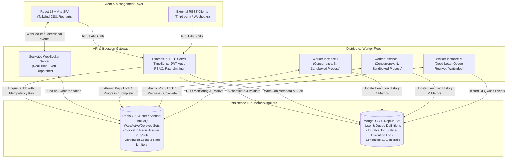

# TaskFlow — Distributed Job Queue & Background Processing System

[](#)
[](#)
[](#)
[](#)
[](#)
[](#)
[](#)
[](#)
[](#)
[](#)
[](#)
[](#)

---

## 1. Executive Summary

**TaskFlow** is an enterprise-grade distributed background job processing platform designed to handle asynchronous, concurrent, and fault-tolerant workload execution at scale. Built with **Node.js, Express, TypeScript, MongoDB, Redis, BullMQ, Socket.io**, and **React**, TaskFlow provides engineers with complete observability and control over long-running background tasks, schedule-based job dispatching, automatic retry mechanisms with exponential backoff, dead-letter queue (DLQ) isolation, and real-time execution analytics.

This project demonstrates core backend and distributed system engineering fundamentals:
- **Asynchronous Task Processing & Concurrency Control** via BullMQ workers and Redis-backed state coordination.
- **Strict Data Consistency & State Synchronization** between in-memory job queues (Redis) and durable document storage (MongoDB).
- **Fault Tolerance & Poison-Pill Isolation** via exponential backoff with jitter, retry limits, and Dead-Letter Queues.
- **Idempotent Job Dispatching** using cryptographic idempotency keys to prevent duplicate execution across distributed workers.
- **Real-Time Distributed Telemetry** powered by Redis Pub/Sub adapters and WebSocket broadcasting (Socket.io).
- **Graceful Degradation & Worker Crash Recovery** using BullMQ lock-renewal heartbeats, stalled job watchdogs, and deterministic POSIX signal handling (`SIGTERM`/`SIGINT`).

---

## 2. System Architecture At A Glance

TaskFlow follows a **Modular Monolith architecture with Decoupled Worker Processes**. The API Gateway/Server and Background Workers share domain schemas, TypeScript models, and database connections while running in isolated OS processes / containers for memory and CPU fault isolation.



---

## 3. Strict Technology Stack

The TaskFlow platform is strictly constrained to high-performance, industry-standard technologies:

| Domain | Technology | Version | Purpose |
| :--- | :--- | :--- | :--- |
| **Frontend Runtime** | React.js | 18.x | Declarative UI dashboard for monitoring and management |
| **Frontend Language** | TypeScript | 5.x | Compile-time type safety across UI components and API contracts |
| **Build Tool** | Vite | 5.x | Ultra-fast HMR and optimized production bundling |
| **Styling** | Tailwind CSS | 3.x | Utility-first responsive design system |
| **Data Visualization** | Recharts | 2.x | Real-time charts for queue throughput, latency, and worker health |
| **Backend Runtime** | Node.js | 20 LTS | Non-blocking asynchronous I/O runtime |
| **Backend Framework** | Express.js | 4.x | REST API server, middleware routing, and request validation |
| **Backend Language** | TypeScript | 5.x | End-to-end typed contracts matching domain models |
| **Database** | MongoDB | 7.0 | Document database for permanent job records, users, and audit trails |
| **ODM** | Mongoose | 8.x | Schema validation, type casting, middleware hooks, and aggregations |
| **In-Memory Broker** | Redis | 7.2 | High-throughput atomic queue primitives, locks, and Pub/Sub |
| **Queue Engine** | BullMQ | 5.x | Redis-backed distributed queue manager with delayed/retry semantics |
| **Real-Time Comms** | Socket.io | 4.x | Low-latency WebSockets with fallback and Redis Pub/Sub adapter |
| **Security & Auth** | JWT + bcrypt | - | Stateless bearer authentication and cryptographic password hashing |
| **Unit & Integration Test** | Jest + Supertest | 29.x | Comprehensive test suite for APIs, workers, and race conditions |
| **Containerization** | Docker & Compose | - | Reproducible multi-service deployment orchestrator |

> **Strict Non-Scope:** No Java, Spring Boot, Python, PostgreSQL, Kafka, or unnecessary external dependencies are used.

---

## 4. Key Architectural Features

1. **Atomic State Transitions**: Redis Lua scripts guarantee that a job is acquired by exactly one worker instance without race conditions.
2. **Dual-Layer Persistence**: Redis handles high-frequency in-flight queue operations; MongoDB guarantees durable audit trails, historical execution analytics, and transactional records.
3. **Strict Idempotency**: Cryptographic hashes of client-supplied or payload-derived tokens prevent duplicate job ingestion and execution.
4. **Resilient Retry Mechanism**: Configurable exponential backoff with randomized jitter prevents thundering herd problems on downstream services.
5. **Dead-Letter Queue (DLQ)**: Jobs failing after maximum retry thresholds are automatically transitioned to a quarantined DLQ for manual triage and replay.
6. **Worker Crash Watchdogs & Stalled Job Detection**: BullMQ lock-renewal heartbeats detect ungraceful worker terminations, re-queueing abandoned jobs automatically.
7. **Role-Based Access Control (RBAC)**: Fine-grained permissions (`admin`, `developer`, `viewer`) controlling queue operations and system administration.
8. **Real-Time Telemetry**: Immediate UI updates via Socket.io rooms segregated by user tenancy and job identifiers.

---

## 5. Comprehensive Documentation Index

All architectural specifications, designs, schemas, and roadmaps are split into dedicated, exhaustive specifications:

| Document | Purpose |
| :--- | :--- |
| [**ARCHITECTURE.md**](./ARCHITECTURE.md) | In-depth modular monolith topology, 10 core architectural modules, component boundaries, and event flow diagrams. |
| [**SYSTEM_DESIGN.md**](./SYSTEM_DESIGN.md) | Distributed systems deep-dive: atomic processing, concurrency, idempotency, failure modes, heartbeat watchdogs, and graceful shutdowns. |
| [**DATABASE_SCHEMA.md**](./DATABASE_SCHEMA.md) | Full Mongoose schemas, TypeScript interfaces, indices, validation rules, and the Redis-vs-MongoDB state segregation matrix. |
| [**API_DOCUMENTATION.md**](./API_DOCUMENTATION.md) | Complete OpenAPI-style REST endpoints, request/response payloads, validation rules, RBAC policies, and RFC 7807 error codes. |
| [**DEVELOPMENT_ROADMAP.md**](./DEVELOPMENT_ROADMAP.md) | 9 phased development milestones, engineering deliverables, verification gates, and acceptance checklists. |
| [**TESTING_STRATEGY.md**](./TESTING_STRATEGY.md) | Comprehensive test pyramid: Unit, Integration, Concurrency & Race Condition, Chaos/Crash, and Performance testing plans. |

---

## 6. Project Directory Layout (Planned Monorepo)

```text
TaskFlow/
├── docs/                             # Architectural and planning documentation
│   ├── ARCHITECTURE.md
│   ├── SYSTEM_DESIGN.md
│   ├── DATABASE_SCHEMA.md
│   ├── API_DOCUMENTATION.md
│   ├── DEVELOPMENT_ROADMAP.md
│   └── TESTING_STRATEGY.md
├── docker/                           # Container definitions and orchestration
│   ├── docker-compose.yml            # Multi-service setup (API, Workers, Mongo, Redis)
│   ├── Dockerfile.api                # Production image for Express API
│   ├── Dockerfile.worker             # Production image for Background Workers
│   └── Dockerfile.frontend           # Multi-stage image for React SPA
├── backend/                          # Backend source code (Modular Monolith)
│   ├── package.json
│   ├── tsconfig.json
│   └── src/
│       ├── config/                   # Env validation, DB, Redis, and Queue configs
│       ├── core/                     # Shared cross-cutting concerns (errors, logger, events)
│       ├── models/                   # Mongoose schemas & TypeScript interfaces
│       ├── modules/                  # Feature modules (Auth, Jobs, Queues, Workers, Analytics)
│       │   ├── auth/                 # JWT, bcrypt, RBAC guards
│       │   ├── jobs/                 # Ingestion, validation, BullMQ publisher
│       │   ├── queues/               # Queue config, pause/resume, concurrency rules
│       │   ├── workers/              # Worker registration & cluster monitoring
│       │   ├── schedules/            # Cron & repeatable job dispatchers
│       │   └── analytics/            # Aggregation pipelines & performance queries
│       ├── sockets/                  # Socket.io setup, Redis adapter, room management
│       ├── server.ts                 # Express HTTP server entrypoint
│       └── worker-entry.ts           # Standalone worker cluster process entrypoint
├── frontend/                         # Frontend React SPA
│   ├── package.json
│   ├── tsconfig.json
│   ├── vite.config.ts
│   ├── tailwind.config.js
│   └── src/
│       ├── assets/                   # Static assets & icons
│       ├── components/               # Reusable UI component library (atomic design)
│       ├── context/                  # AuthContext, SocketContext, ThemeContext
│       ├── hooks/                    # Custom React hooks (useSocket, useJobs, useMetrics)
│       ├── layouts/                  # AppLayout, DashboardLayout, AuthLayout
│       ├── pages/                    # 10 Dashboard & Authentication pages
│       ├── services/                 # Axios HTTP client & API service wrappers
│       ├── types/                    # Shared frontend TypeScript interfaces
│       ├── App.tsx                   # Route definitions & top-level providers
│       └── main.tsx                  # Client bootstrapping
└── README.md                         # Project overview and index
```

---

## 7. Current Project Status

- **Phase**: **Milestone 3 — Job Submission & BullMQ Integration (Complete & Verified)**
- **Verification Summary**:
  - Full TypeScript monorepo compilation (`npm run build`, `npm run typecheck`) across `@taskflow/shared`, `@taskflow/backend`, and `@taskflow/frontend`: **0 errors**.
  - ESLint verification (`npm run lint`): **0 errors, 0 warnings**.
  - Automated Jest test suites: **13 suites, 101 tests passed, 0 failed** (7 shared + 94 backend).
  - Background BullMQ worker runtime, demonstration processors (`EMAIL_SIMULATION`, `DATA_PROCESSING`, `REPORT_GENERATION`), dual-write reconciliation sweeper, and React UI fully operational.

---

## 8. Local Setup & Execution Guide

### Prerequisites
- Node.js 20 LTS
- MongoDB 7.0+ (running locally or in Docker)
- Redis 7.2+ (running locally or in Docker)

### Installation
```bash
# Clone the repository
git clone https://github.com/your-username/taskflow.git
cd taskflow

# Install monorepo dependencies across all workspaces
npm install
```

### Environment Configuration
Copy `.env.example` in `backend` and `frontend`:
```bash
cp backend/.env.example backend/.env
cp frontend/.env.example frontend/.env
```

### Development Scripts
```bash
# 1. Run Shared Package Build
npm run build --workspace=@taskflow/shared

# 2. Start Express API Backend (Port 5000)
npm run dev --workspace=@taskflow/backend

# 3. Start Standalone Background Worker Process
npm run dev:worker --workspace=@taskflow/backend

# 4. Start React Frontend Dashboard (Port 5173)
npm run dev --workspace=@taskflow/frontend
```

### Running Test Suites & Quality Verification
```bash
# Run complete automated test suite across monorepo workspaces
npm test --workspace=@taskflow/shared
npm test --workspace=@taskflow/backend
npm test --workspace=@taskflow/frontend

# Run strict TypeScript typechecking across all 3 workspaces
npm run typecheck

# Run ESLint across codebases
npm run lint

# Compile production bundles
npm run build
```
