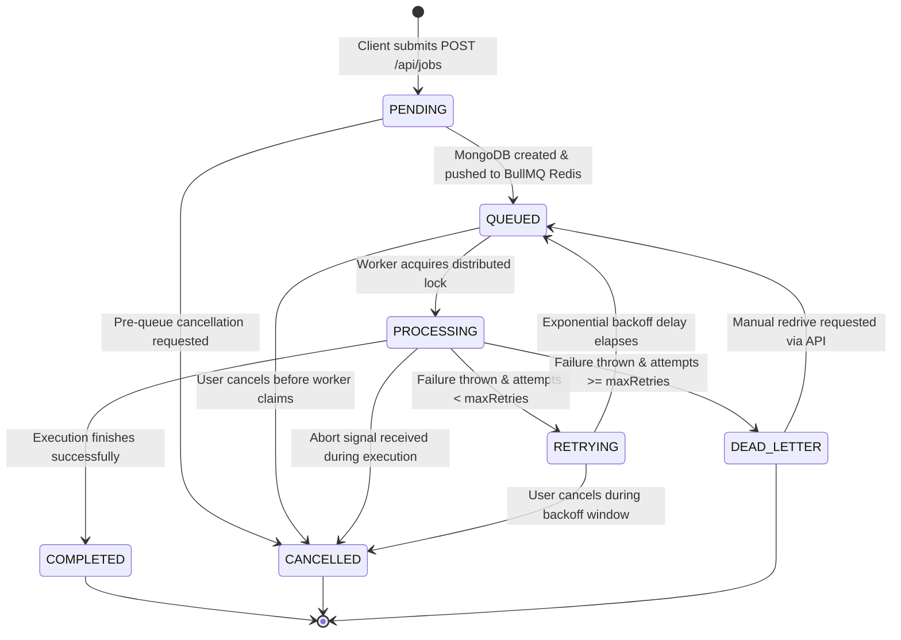
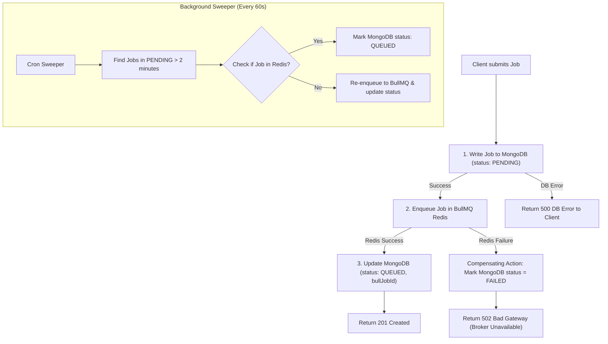
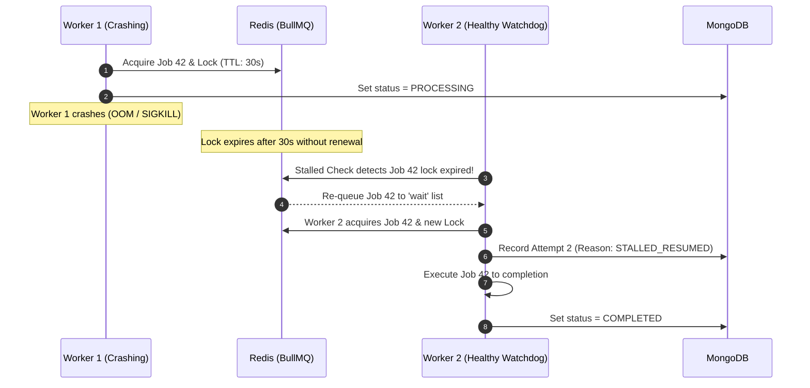
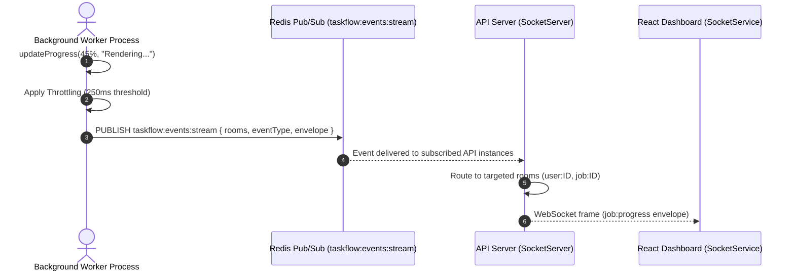

# TaskFlow — Distributed System Design Specification

## 1. Complete Job Lifecycle & State Machine

The core of TaskFlow is a deterministic finite state machine (FSM) governing every job's life from client submission through completion or dead-letter quarantine.

### 1.1 State Machine Diagram

### 1.2 State Transition Matrix and Synchronization Semantics

| Transition | BullMQ State | MongoDB State | Synchronization Mechanism | Atomicity & Invariant Enforced |
| :--- | :--- | :--- | :--- | :--- |
| **Submission** | Not yet queued | `PENDING` | API Controller creates DB doc first; then invokes `queue.add()` | If Redis enqueue fails, DB record is updated to `FAILED` or cleaned up. |
| **Enqueued** | `wait` / `delayed` | `QUEUED` | BullMQ assigns numeric `bullJobId`; MongoDB stores reference | `Job.bullJobId` and `Job.status = 'QUEUED'` updated atomically. |
| **Worker Pickup** | `active` | `PROCESSING` | BullMQ worker emits `active` event; worker updates DB | Worker acquires exclusive Redis lock token and updates `Job.lockedBy`. |
| **Success** | `completed` | `COMPLETED` | Worker emits `completed` event; updates DB with execution duration and output | BullMQ removes job from active set; DB stores permanent result payload. |
| **Transient Fail** | `delayed` (backoff) | `RETRYING` | Worker emits `failed` event; BullMQ calculates backoff delay | Attempt count incremented in MongoDB `JobExecution` and `Job.currentRetries`. |
| **Terminal Fail** | `failed` / custom DLQ | `DEAD_LETTER` | Worker checks `job.attemptsMade >= job.opts.attempts`; moves to DLQ | Removed from active processing rotation; quarantined for audit. |
| **Cancellation** | `removed` / aborted | `CANCELLED` | API deletes from BullMQ or triggers `AbortSignal` for running worker | Invariant: no further retries or worker execution allowed once cancelled. |

---

## 2. Distributed System Challenges & Concrete Engineering Solutions

### 2.1 Atomic Job Processing
In a distributed environment with multiple workers reading from the same queue, two workers must never process the same job concurrently.

**BullMQ & Redis Lua Implementation:**
1. BullMQ leverages Redis `RPOPLPUSH` (or `LMOVE` in Redis 6.2+) and complex Lua scripts executed atomically on the Redis single-threaded engine.
2. When a worker requests work, the Redis script atomically:
   - Moves the job ID from the `wait` list to the `active` list.
   - Assigns an exclusive lock with an expiration (TTL = 30 seconds).
   - Generates a unique lock token held exclusively by the claiming worker process.
3. No two workers can acquire the same job ID because the Lua script executes atomically within a single Redis engine evaluation cycle.

### 2.2 Dual-Write Consistency & Reconciliation
A common distributed systems failure occurs when writing to both MongoDB and Redis (the dual-write problem). If MongoDB commits a record but Redis is unreachable (or vice versa), the system enters an inconsistent state.

**TaskFlow Dual-Write Mitigation Strategy:**

### 2.3 Strict Idempotency & Duplicate Execution Prevention
Network retries, browser re-clicks, and webhook re-deliveries can cause duplicate job creation. TaskFlow implements a dual-tier idempotency system:

1. **Client-Facing Request Deduplication**:
   - Clients supply an `Idempotency-Key` HTTP header (or UUID).
   - The API server checks MongoDB for an existing job with `idempotencyKey: headerValue`.
   - If found and created within the idempotency window (24 hours), the server immediately returns the cached job object with HTTP `200 OK` (or `409 Conflict` if currently in flight) without re-enqueuing.
   - An exact unique index `{ idempotencyKey: 1 }` in MongoDB prevents concurrent race conditions on insertion.

2. **Queue-Level Deduplication**:
   - When calling BullMQ `queue.add(name, data, { jobId: idempotencyKey })`, BullMQ uses the custom `jobId` in Redis.
   - If a job with that `jobId` already exists in Redis (in `wait`, `active`, or `delayed`), BullMQ rejects or ignores the duplicate addition.

3. **Worker-Level Idempotency Guard**:
   - Before executing side-effects (e.g., sending an external email or charging a payment), workers verify the target entity's state in MongoDB.

### 2.4 Worker Crashes, Heartbeats & Stalled Job Recovery
If a background worker process experiences a hardware failure, Out-Of-Memory (OOM) crash, or `kill -9` while executing a job, the job must not remain permanently locked in `PROCESSING` status.

**BullMQ Lock Renewal and Watchdog Mechanism:**
1. **Lock Heartbeat**: While a job is executing, the worker maintains a background timer that renews the Redis lock every 15 seconds (lock duration: 30s).
2. **Stalled Job Detection**:
   - Every worker runs a BullMQ stalled-job watchdog at a configurable interval (`stalledInterval: 30000ms`).
   - The watchdog inspects the `active` set for jobs whose lock has expired (meaning the worker died and stopped sending lock renewals).
   - The stalled job is moved back to the `wait` queue to be picked up by another healthy worker.
3. **MongoDB Synchronization**:
   - The worker picking up the stalled job increments `JobExecution.attemptNumber` and logs a `WORKER_STALLED_RECOVERY` event.
   - If a job stalls more than `maxStalledCount` (default: 2), it is marked as `DEAD_LETTER` to prevent infinite restart loops.

### 2.5 Resilient Retry Management: Exponential Backoff with Jitter
When a worker encounters a transient error (e.g., third-party API 503, database connection blip), retrying immediately can trigger a thundering herd problem.

TaskFlow uses exponential backoff augmented by randomized **Full Jitter**:
$$\text{Backoff}(attempt) = \min(\text{maxDelay}, \text{initialDelay} \times 2^{attempt - 1})$$
$$\text{DelayWithJitter} = \text{random}(0, \text{Backoff}(attempt))$$

**Parameters:**
- `initialDelay`: 1,000 ms (1 second)
- `maxDelay`: 300,000 ms (5 minutes)
- `factor`: 2
- `maxRetries`: Configurable per job (default: 3)

### 2.6 Dead-Letter Queue (DLQ) Architecture & Redrive
When a job fails after exhausting all retry attempts ($attemptsMade \ge maxRetries$), it is quarantined to prevent continuous worker resource consumption.

1. **Quarantine Execution**:
   - Worker catches final failure event.
   - Job is moved out of active queue rotation into the Dead-Letter Queue: `taskflow-dlq`.
   - MongoDB updates `Job.status = 'DEAD_LETTER'` and captures the complete stack trace and failure timestamp.
2. **Alerting & Observation**:
   - A real-time WebSocket event `job:dead_letter` is fired to the React dashboard.
3. **Redrive Mechanism**:
   - Operators can inspect the failed payload in the UI, fix downstream issues, and trigger `POST /api/jobs/:id/retry`.
   - The API resets `currentRetries: 0`, generates a new BullMQ job reference, and pushes it back into the primary queue.

### 2.7 Graceful Shutdown Protocol (POSIX Signals)
When Kubernetes or Docker stops a worker container (`SIGTERM` or `SIGINT`), in-flight jobs must not be abruptly terminated.

**Deterministic Shutdown Sequence:**
1. Worker receives `SIGTERM`.
2. Process pauses BullMQ worker: `await worker.pause(true)`. This stops the worker from pulling new jobs from Redis.
3. A shutdown countdown timer begins (default: 25 seconds).
4. Running jobs are allowed to finish.
5. If running jobs do not finish within the grace period, `AbortController` triggers cancellation.
6. Worker closes Redis and MongoDB connections cleanly:
   - `await worker.close()`
   - `await mongoose.connection.close()`
   - `await redisClient.quit()`
7. Process exits with code `0`.

---

### 2.8 Real-Time Telemetry & Cross-Process Event Streaming
In a production deployment, worker processes run decoupled from API web instances. A worker in an external process cannot emit directly to an in-memory Socket.io server.

**Distributed Event Flow & Throttling Architecture:**

1. **Cross-Process Pub/Sub**: Workers publish event envelopes to Redis channel `taskflow:events:stream`. All running API server nodes subscribe to this channel and route events into local Socket.io rooms.
2. **Horizontal Scalability**: `@socket.io/redis-adapter` enables multiple API server instances to distribute WebSocket broadcasts across clients connected to different nodes.
3. **Progress Rate Throttling**: Progress events (1%-99%) are limited to at most 1 emission per 250ms per job. Boundary values (0% started and 100% completed) are exempt from throttling to guarantee instant status responsiveness.
4. **Resilient Reconnection**: `SocketService` on the frontend tracks active room memberships and automatically issues resubscription commands when the connection recovers after a transient network drop.
