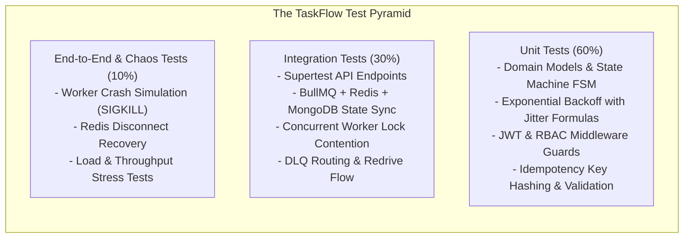

# TaskFlow — Comprehensive Testing Strategy

## 1. Testing Philosophy & Test Pyramid

TaskFlow is a mission-critical distributed asynchronous processing engine. Failures in concurrency, state transitions, or distributed locks can lead to duplicate executions, lost jobs, or data corruption. Testing must verify both happy paths and edge cases (worker crashes, race conditions, network partitions).



---

## 2. Test Tooling & Environment Configuration

| Tool | Purpose | Configuration Details |
| :--- | :--- | :--- |
| **Jest** | Test Runner & Assertion Library | Configured with `ts-jest` for native TypeScript support without pre-compilation |
| **Supertest** | HTTP Integration Testing | Executes HTTP requests directly against Express `app` without binding real ports |
| **mongodb-memory-server** | In-Memory MongoDB Instance | Spawns isolated ephemeral MongoDB instances for fast, isolated integration tests |
| **ioredis-mock / Real Redis**| Redis Queue Testing | Unit tests use `ioredis-mock`; integration/concurrency tests run against a dedicated Docker Redis container |
| **Autocannon / Artillery** | Load & Concurrency Stress Testing | Generates high-concurrency HTTP bursts to measure throughput, latency, and race conditions |

---

## 3. Detailed Test Suites by Domain

### 3.1 Authentication & Authorization Test Suite (`auth.spec.ts`)
- **Password Cryptography**:
  - Verify password hash generation uses `bcrypt` with $\ge 12$ salt rounds.
  - Ensure plaintext passwords are never returned in user objects or stored in logs.
- **JWT Lifecycle**:
  - Issue valid Access Token and verify payload (`userId`, `role`).
  - Attempt request with expired token $\rightarrow$ Expect `401 Unauthorized`.
  - Attempt request with tampered signature $\rightarrow$ Expect `401 Unauthorized`.
- **Role-Based Access Control (RBAC)**:
  - As `viewer`, attempt `POST /api/jobs` $\rightarrow$ Expect `403 Forbidden`.
  - As `developer`, attempt `POST /api/queues` $\rightarrow$ Expect `403 Forbidden` (admin only).
  - As `admin`, attempt `POST /api/queues` $\rightarrow$ Expect `201 Created`.

### 3.2 Job Submission & Idempotency Test Suite (`jobs.spec.ts`)
- **Payload Validation**:
  - Submit job with missing required fields $\rightarrow$ Expect `400 Bad Request` with field-level RFC 7807 error schema.
  - Submit job with out-of-bounds priority ($<1$ or $>10$) $\rightarrow$ Expect `400 Bad Request`.
- **Strict Idempotency Verification**:
  - Send `POST /api/jobs` with `Idempotency-Key: test-key-101`.
  - Expect `201 Created` with a new `bullJobId`.
  - Re-send exact same request with `Idempotency-Key: test-key-101`.
  - Expect `200 OK` (or `409 Conflict`) returning the existing job ID without creating a duplicate record in MongoDB or Redis.
- **Simultaneous Race Condition Ingestion**:
  - Fire 10 concurrent HTTP requests with the *exact same* idempotency key simultaneously using `Promise.all()`.
  - Assert that exactly **one** job is created in MongoDB and BullMQ; the other 9 requests return idempotency conflict responses.

### 3.3 Queue Processing & Priority Ordering Test Suite (`queue.spec.ts`)
- **Priority Ingestion & Dequeue Order**:
  - Enqueue 3 jobs in order: Job A (priority: 5), Job B (priority: 1 - High), Job C (priority: 10 - Low).
  - Start worker with concurrency 1.
  - Verify worker dequeues and processes in order: Job B (1) $\rightarrow$ Job A (5) $\rightarrow$ Job C (10).
- **Delayed Execution**:
  - Enqueue job with `delayMs: 3000`.
  - Verify job immediately resides in Redis `delayed` sorted set.
  - Verify worker does not process the job before 3000ms have elapsed.

### 3.4 Concurrency & Distributed Lock Test Suite (`worker-concurrency.spec.ts`)
- **Exclusive Lock Enforcement**:
  - Spawn 5 worker instances subscribing to the same queue.
  - Enqueue 100 jobs.
  - Monitor active execution set in Redis and `JobExecution` collection.
  - Assert that no single job ID has two concurrent `JobExecution` records in status `PROCESSING`.
  - Assert that total concurrent active jobs never exceeds $\sum (\text{worker concurrency})$.

### 3.5 Retry Mechanisms & Exponential Backoff Test Suite (`retry.spec.ts`)
- **Backoff Math & Jitter Verification**:
  - Unit test `BackoffCalculator.computeDelay(attempt, baseDelay, maxDelay)`.
  - Verify exponential doubling: Attempt 1 $\approx 1000\text{ms}$, Attempt 2 $\approx 2000\text{ms}$, Attempt 3 $\approx 4000\text{ms}$.
  - Verify jitter boundaries: $0 \le \text{delay} \le \text{maxDelay}$.
- **Transient Failure Handling**:
  - Configure mock worker handler to throw error on Attempt 1 and succeed on Attempt 2.
  - Assert MongoDB transitions: `QUEUED` $\rightarrow$ `PROCESSING` $\rightarrow$ `RETRYING` $\rightarrow$ `PROCESSING` $\rightarrow$ `COMPLETED`.
  - Assert two `JobExecution` records are created for attempts 1 and 2 with appropriate error logs.

### 3.6 Dead-Letter Queue (DLQ) & Poison Pill Suite (`dlq.spec.ts`)
- **Max Retries Exhaustion**:
  - Configure job with `maxRetries: 2`.
  - Mock worker handler throws persistent `FatalProcessingError`.
  - Worker executes Attempt 1 (fails) $\rightarrow$ Retrying $\rightarrow$ Attempt 2 (fails) $\rightarrow$ Retrying $\rightarrow$ Attempt 3 (final attempt fails).
  - Verify job is moved out of active BullMQ queue into DLQ.
  - Verify MongoDB `Job.status = 'DEAD_LETTER'`.
  - Verify `Job.failureReason` contains the terminal error stack trace.
- **DLQ Redrive API**:
  - Call `POST /api/jobs/:id/retry` on the quarantined job.
  - Verify status resets to `QUEUED` and a new execution cycle starts with `currentRetries = 0`.

### 3.7 Crash & Stalled Job Recovery Test Suite (`recovery.spec.ts`)
- **Abrupt Worker Crash (SIGKILL Simulation)**:
  - Worker 1 claims job and enters `PROCESSING` state.
  - Forcefully kill Worker 1 process (`process.exit(1)` or `worker.disconnect()`) without clean shutdown.
  - Advance mock Redis time past BullMQ lock TTL (30s) or wait for lock timeout.
  - Start Worker 2.
  - Assert Worker 2 stalled-job watchdog identifies abandoned lock, re-queues job, and completes execution successfully.

### 3.8 Frontend SPA Test Suite (`frontend/src/__tests__`)
- **Authentication & RBAC Entitlements (`auth-rbac.spec.ts`)**:
  - In-memory JWT access token storage and header attachment.
  - Role-based entitlements matrix for Viewer, Developer, and Admin.
  - Route guard enforcement and session cleanup.
- **Job API Service & DLQ Client (`job-service-dlq.spec.ts`)**:
  - Idempotency key header propagation on job submission.
  - Pagination, search, status, and sorting query parameter serialization.
  - Job retry, cancellation, single DLQ redrive, and bulk DLQ redrive API contracts.
  - Dead-letter queue statistics calculation and queue breakdown mapping.
- **Socket Real-Time Lifecycle (`socket-realtime.spec.ts`)**:
  - Singleton client instance guarantee and connection status tracking.
  - Reactive status change listener registration and cleanup.
  - Safe room subscriptions and unsubscriptions (`subscribeJob`, `subscribeQueue`).

---

## 4. Test Execution Commands & CI Pipeline Matrix

```bash
# Run shared types test suite
npm test --workspace=@taskflow/shared

# Run backend unit, integration, and security test suites
npm test --workspace=@taskflow/backend

# Run frontend SPA test suite
npm test --workspace=@taskflow/frontend

# Run strict TypeScript typecheck
npm run typecheck

# Run ESLint across codebases
npm run lint
```

---

## 5. Milestone 3 Verification Matrix (Verified 101/101 Tests)

| Test Suite File | Domain / Category | Tests Passed | Status |
| :--- | :--- | :--- | :--- |
| `shared/src/__tests__/shared-types.spec.ts` | Shared Types, Enums & FSM Transitions | 7 / 7 | PASS |
| `backend/tests/unit/job-validation.test.ts` | Zod Validation, Priority, Payload Sanitization | 5 / 5 | PASS |
| `backend/tests/unit/processor-registry.test.ts` | Processor Registry & Handlers (Email, Data, Report) | 6 / 6 | PASS |
| `backend/tests/unit/reconciliation.test.ts` | Dual-Write Reconciliation & Orphaned State Recovery | 3 / 3 | PASS |
| `backend/tests/unit/token.service.test.ts` | JWT Token Generation & Verification | 3 / 3 | PASS |
| `backend/tests/unit/env.config.test.ts` | Environment Configuration Validation | 2 / 2 | PASS |
| `backend/tests/unit/app-error.test.ts` | Error Hierarchy & Status Codes | 4 / 4 | PASS |
| `backend/tests/integration/job-submission.test.ts` | Job Submission, RBAC, Idempotency, User Isolation | 14 / 14 | PASS |
| `backend/tests/integration/worker-execution.test.ts` | Worker Execution, Progress, Retry, DLQ, Cancellation | 5 / 5 | PASS |
| `backend/tests/integration/security-hardening.test.ts` | Refresh Token Rotation Race & Concurrency | 6 / 6 | PASS |
| `backend/tests/integration/auth.test.ts` | User Authentication, Rotation & Inactive Accounts | 18 / 18 | PASS |
| `backend/tests/integration/rbac.test.ts` | Role Hierarchy & Middleware Enforcement | 24 / 24 | PASS |
| `backend/tests/integration/health.test.ts` | Liveness & Readiness Probes | 4 / 4 | PASS |
| **Monorepo Total** | **All 13 Suites Combined** | **101 / 101** | **100% PASS** |
